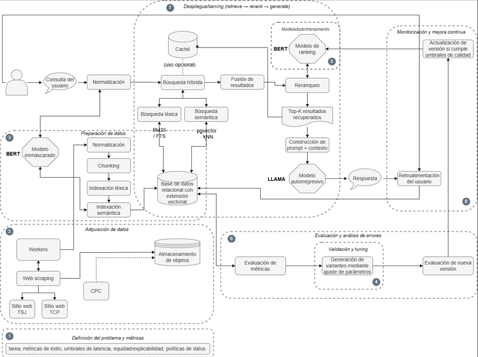

# Alexandria — Backend & AI Retrieval Engine

Backend API and AI-powered information retrieval system for **Alexandria**, a legal research assistant designed for the Bolivian legal context.

Alexandria was developed as a Computer Systems Engineering degree project for Sanjinés & Asociados. It helps legal professionals find relevant legislation and case law through natural-language queries, hybrid retrieval, and evidence-grounded AI responses.

## Tech Stack

| Area | Technologies |
|---|---|
| Language | Python |
| Backend | Django, Django REST Framework |
| Database | PostgreSQL, pgvector |
| Cache & Tasks | Redis, Celery |
| Authentication | JWT, Email OTP, RBAC |
| AI / NLP | RAG, BGE-M3, BGE Reranker, Llama 3 |
| Search | BM25 / Full-Text Search, Vector Similarity, RRF |
| Infrastructure | Docker |
| Testing | Django unit tests, Postman |

## Core Features

### Authentication & Access Control

- Controlled registration through a user whitelist
- Email-based OTP verification
- JWT authentication
- Password recovery using email OTP
- Role-based access control (`admin` / `user`)
- Request throttling and access validation

### AI-Powered Legal Research

Alexandria implements a Retrieval-Augmented Generation (RAG) pipeline designed to retrieve and prioritize relevant Bolivian legal documents before generating responses.

**Retrieval pipeline:**

1. Collect publicly available legal documents.
2. Extract, normalize, and segment document content.
3. Generate semantic embeddings using BGE-M3.
4. Store document metadata and vectors in PostgreSQL with pgvector.
5. Retrieve candidates through BM25 and vector similarity search.
6. Combine retrieval signals using Reciprocal Rank Fusion (RRF).
7. Re-rank candidates using a cross-encoder and legal relevance signals.
8. Generate evidence-grounded responses using Llama 3.
9. Return supporting citations and document references.

### Document Processing

- Legal document ingestion through web scraping
- Text extraction and normalization
- Document chunking and metadata preservation
- Lexical and semantic indexing
- Background processing with Celery
- Source traceability for retrieved documents

### Search & Session Management

- Natural-language legal queries
- Query history and session management
- Retrieved document references
- Integrated document access
- Relevance feedback on search results

### Feedback & Ranking Improvement

The system incorporates feedback from legal professionals to evaluate and refine retrieval quality.

- Feedback collection at result level
- Ranking decision tracking
- Training of updated ranking weights
- Version evaluation and controlled promotion
- Retrieval quality and latency monitoring

## System Architecture

### Retrieval-Augmented Generation (RAG) Pipeline

Alexandria implements a Retrieval-Augmented Generation (RAG) architecture designed to provide accurate, context-aware legal research grounded in Bolivian legislation and case law.

The architecture integrates document ingestion, hybrid information retrieval, semantic re-ranking, and LLM-based response generation into a unified pipeline.

  

### Architecture Overview

The system consists of five main components:

1. **Data Ingestion & Processing:** Legal documents are collected from official Bolivian judicial sources, normalized, segmented into chunks, and indexed for retrieval.

2. **Hybrid Search:** Combines lexical retrieval (BM25 / Full-Text Search) with semantic vector search using embeddings stored in PostgreSQL with pgvector.

3. **Re-ranking:** Retrieved candidates are merged and prioritized using Reciprocal Rank Fusion (RRF) and a cross-encoder re-ranking model to improve contextual relevance.

4. **Response Generation:** The most relevant passages are supplied as context to a Llama-based language model, generating responses supported by citations to the original legal documents.

5. **Feedback & Continuous Improvement:** User relevance feedback is collected to evaluate retrieval quality, refine ranking weights, and support controlled model version updates.

This architecture separates data preparation, retrieval, ranking, and generation, enabling individual components to be evaluated and improved independently.

## Evaluation & Results

The system was evaluated through functional tests, technical tests, and user testing with legal professionals.

Results demonstrated:

- Identification of useful legal documents within seconds
- Reduction of document collection time from over an hour to minutes
- Fewer manual search iterations and document openings
- Improved access to supporting legal sources
- Positive feedback on usability and research workflow integration

## Development

The project uses Docker-based infrastructure with PostgreSQL and Redis.

Refer to the repository's configuration files for the exact environment variables, services, migrations, and startup commands required for local development.

## Project Context

Alexandria was developed in 2025 as an applied research and software engineering project at Universidad Privada del Valle (Univalle), Bolivia.

**Author:** Sabine Lohner Villarroel

**Focus:** Backend Engineering, Information Retrieval, Applied Machine Learning, Natural Language Processing, and LegalTech.

## Disclaimer

Alexandria is a legal research support tool. AI-generated responses must be verified against their cited legal sources and do not constitute legal advice.
